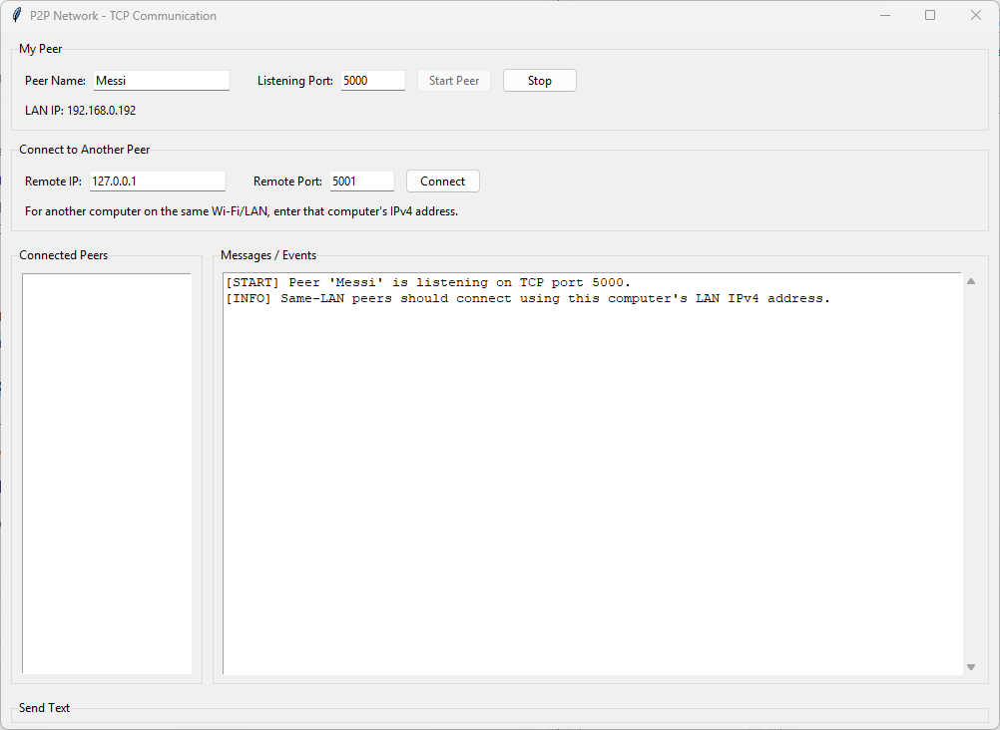
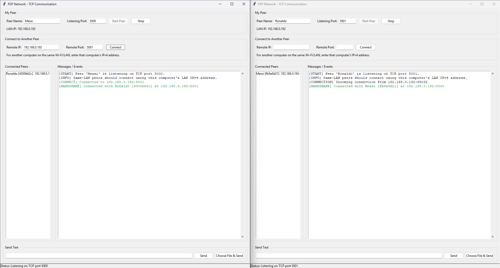
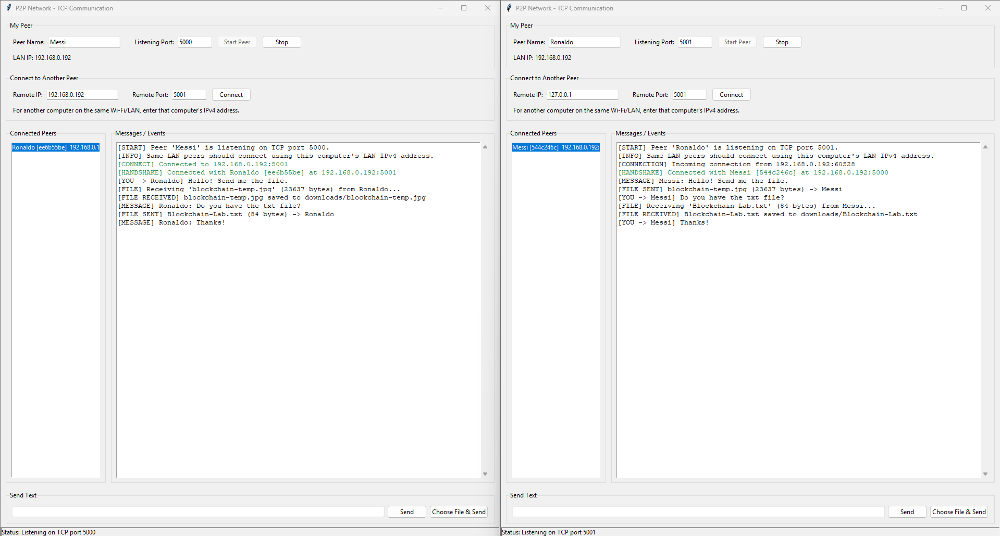
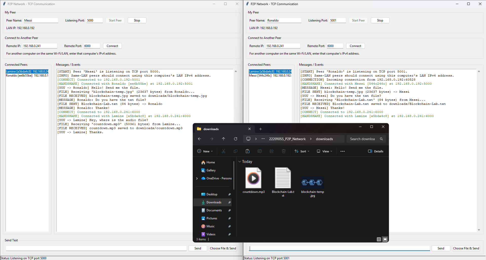
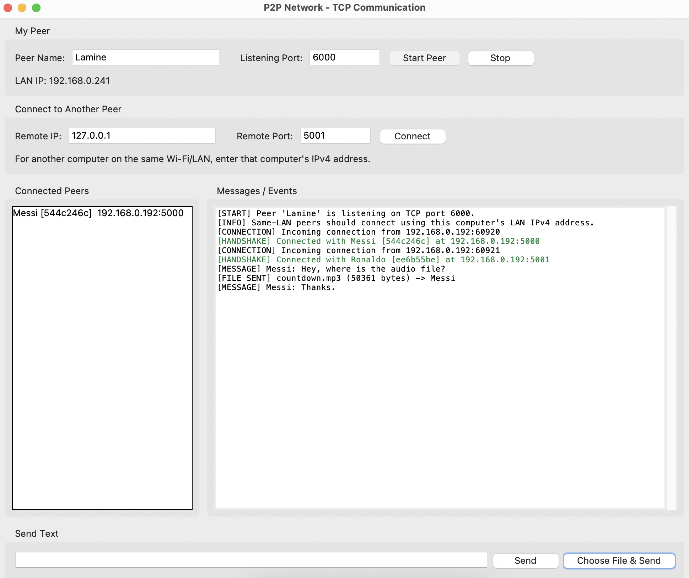
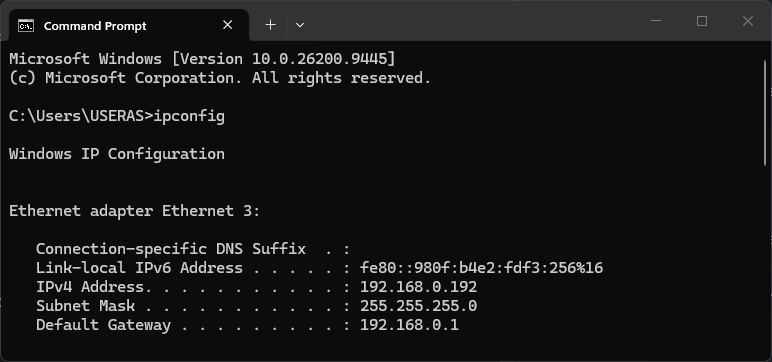
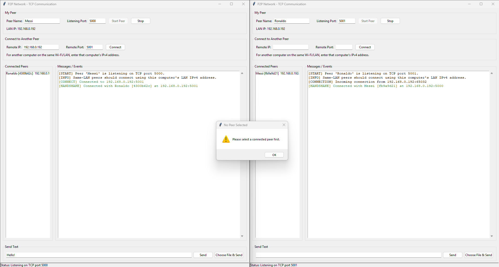
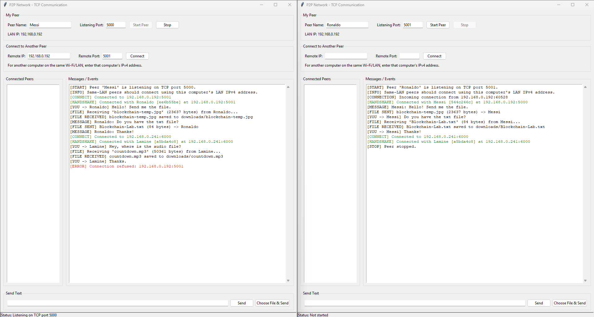
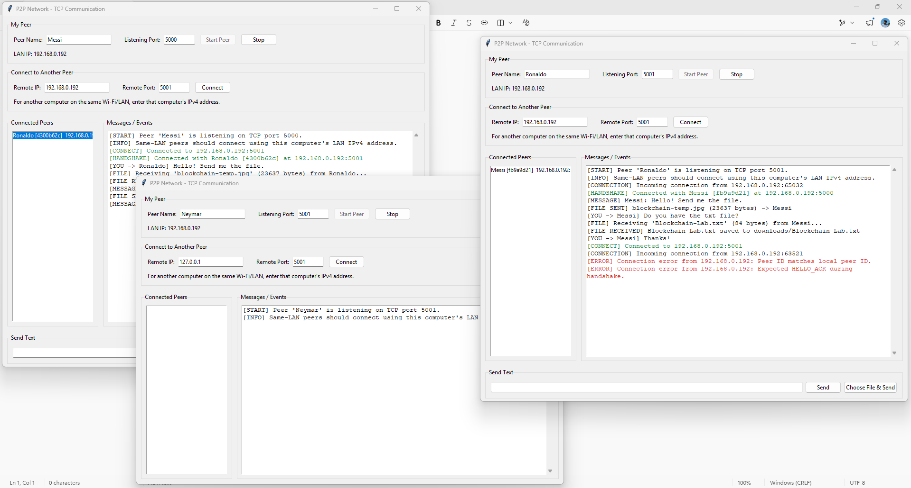

# P2P Network Communication and File Sharing

**Course:** CSE 434 - Blockchain & Distributed Security Lab  
**Language:** Python  
**Communication:** TCP Sockets  
**Project Type:** Lightweight Peer-to-Peer Networking Application

---

## 1. Project Overview

This project implements a lightweight **Peer-to-Peer (P2P) communication application** using Python TCP sockets. The main idea is that every running copy of the application represents one **peer**. A peer can perform both roles:

- **TCP Server:** accepts incoming connections from other peers.
- **TCP Client:** initiates connections to other peers.

There is no central server responsible for forwarding messages.

The application supports:

1. Starting a peer with a peer name and listening port.
2. Connecting directly to another peer using IP address and port.
3. HELLO/HELLO_ACK peer identification.
4. Displaying connected peers.
5. Sending text messages and ordinary binary files.
6. Receiving files into a local `downloads/` folder.
7. Maintaining multiple peer connections using threads.
8. Testing on the same computer.
9. Testing between different computers connected to the same LAN/Wi-Fi.
10. Basic network and file-transfer error handling.

---

# 2. Objective

The objective is to understand practical P2P networking through:

- IP addresses
- Port numbers
- TCP sockets
- TCP server/client communication
- Threads
- Application-level protocols
- Message framing
- Text communication
- Binary file transfer
- Multiple simultaneous peer connections

The project is not intended to implement a blockchain, cryptocurrency, BitTorrent, DHT or other advanced P2P infrastructure.

---

# 3. System Architecture

Each running application is both a TCP server and a TCP client.

```text
                        P2P Network

                 +----------------------+
                 |        Peer A        |
                 |                      |
                 | TCP Server + Client  |
                 +----------+-----------+
                            |
                        Direct TCP
                            |
             +--------------+--------------+
             |                             |
      +------+-------+              +------+-------+
      |    Peer B    |              |    Peer C    |
      |              |              |              |
      | Server+Client|              | Server+Client|
      +--------------+              +--------------+
```

There is no central server.

A peer can connect directly to another peer by specifying:

```text
IP Address + Port Number
```

---

# 4. Project Concept

Every peer has two networking responsibilities.

## Server side

The peer:

```text
socket()
bind()
listen()
accept()
```

This allows other peers to connect to it.

## Client side

The peer:

```text
socket()
connect()
```

This allows it to connect to another peer.

Therefore:

```text
Every Peer = TCP Server + TCP Client
```

---

# 5. Project Structure

```text
P2P_Network/
│
├── main.py
├── p2p_node.py
├── protocol.py
├── requirements.txt
├── README.md
│
└── downloads/
```

## File responsibilities

| File | Responsibility |
| :--- | :--- |
| `main.py` | Tkinter graphical user interface showed in the attached screenshots. |
| `p2p_node.py` | Contains main networking implementation, thread lifecycle management, connection tracking and message dispatch. |
| `protocol.py` | Contains application-level protocol constants: `hello`, `hello_ack`, `text`, `file`. |
| `requirements.txt` | Documents that only Python's standard library is used, no third party packages required. |
| `downloads/` | Dedicated local storage directory for received files. |
| `README.md` | Setup guide, usage instructions and architecture details. |

---

# 6. Technologies Used

- **Python:** Python 3.9+ (tested and verified on Python 3.14.3).
- **Libraries:** Python Standard Library only (`socket`, `threading`, `tkinter`, `json`).
- **Operating System:** Windows, Linux or macOS.
- **Network:** Localhost (single computer testing) or LAN/Wi-Fi network (multi-computer testing).

No external Python packages are required.

---

# 7. Application-Level Protocol

The project uses JSON for control messages.

Supported message types:

```text
hello
hello_ack
text
file
```

---

## 7.1 HELLO

When two peers establish a connection, they identify themselves.

Example:

```json
{
    "type": "hello",
    "peer_id": "a83f21c4",
    "peer_name": "Messi",
    "port": 5000
}
```
---

## 7.2 HELLO_ACK

The receiving peer responds:

```json
{
    "type": "hello_ack",
    "peer_id": "92bd71e3",
    "peer_name": "Ronaldo",
    "port": 5001
}
```

This establishes peer identity information.

---

## 7.3 Text message

Example:

```json
{
    "type": "text",
    "sender_id": "a83f21c4",
    "sender_name": "Messi",
    "message": "Hello!"
}
```

---

## 7.4 File metadata

Before sending file bytes, the sender sends metadata:

```json
{
    "type": "file",
    "sender_id": "a83f21c4",
    "sender_name": "Messi",
    "filename": "blockchain-temp.jpg",
    "filesize": 23637
}
```

The raw file bytes are then sent immediately after the metadata.

---

# 8. Message Framing

TCP is a byte-stream protocol. Therefore, the receiver cannot assume that one `recv()` call represents one complete JSON message.

The project uses:

```text
+----------------+----------------------+
| 4-byte length  |    JSON payload      |
+----------------+----------------------+
```

The 4-byte length is stored as an unsigned big-endian integer.

The receiver:

1. Reads 4 bytes.
2. Converts them into the JSON payload length.
3. Reads exactly that many bytes.
4. Decodes the JSON.

This provides application-level message boundaries.

---

# 9. File Transfer

Files are treated as binary data.

The project does not create separate protocols for:

- images
- audio
- video
- PDFs
- ZIP files
- text files

Instead, all files follow the same process:

```text
File metadata → Raw file bytes → Receiver → downloads/
```

The file is read and transmitted in chunks of **64 KB**.

This avoids loading a large file completely into memory. The receiver uses the `filesize` value from the metadata to know exactly how many bytes belong to the file.

---

# 10. Multiple Peer Connections

Each connection is handled independently using a Python thread.

Conceptually:

```text
                 Main Peer
                     |
          +----------+----------+
          |          |          |
       Thread A   Thread B   Thread C
          |          |          |
        Peer A     Peer B     Peer C
```

This allows the local peer to remain available for multiple connections.

---

# 11. Running the Project

### Option 1: Download the project

1. Download the repository as a *ZIP* file.
2. Extract it to a folder on your computer.
3. Open the extracted folder.

### Option 2: Clone the repository

```bash
git clone https://github.com/MarzzzSiam/Blockchain-and-Distributed-Security.git
cd Blockchain-and-Distributed-Security
cd P2P-Network
```

## How to run the application

From the project folder, run:

```bash
python main.py
```

If `python` is not recognized on Windows, use:

```bash
py main.py
```

A window titled `P2P Network - TCP Communication` will open.


---

# 12. Same Computer Testing

Multiple instances can be run on one computer.

### Peer A

```text
Name: Messi
Port: 5000
```

### Peer B

```text
Name: Ronaldo
Port: 5001
```

Start both applications.



From Peer A:

```text
Remote IP: 192.168.0.192
Remote Port: 5001
```

Click:

```text
Connect
```

Now Messi and Ronaldo should appear as connected peers.



They can test:

- text messages
- image transfer
- file transfer
- audio transfer
- video transfer



---

# 13. Same LAN/Wi-Fi Testing

The application also supports communication between **different computers connected to the same LAN/Wi-Fi network**.

This is an important part of the intended P2P behavior.

### Computer A

```text
Peer Name: Messi
LAN IP: 192.168.0.192
Port: 5000
```

### Computer B

```text
Peer Name: Lamine
LAN IP: 192.168.0.241
Port: 6000
```

On Computer A, connect to:

```text
Remote IP: 192.168.0.241
Remote Port: 6000
```

The connection is:

```text
Computer A
    |
    | TCP
    |
    v
192.168.0.241:6000
    |
    v
Computer B
```

### Preview: Computer A



### Preview: Computer B


---

# 14. Finding the LAN IP

When the peer starts, the application displays:

```text
LAN IP: 192.168.x.x
```

This address will be used on the other computer.

If automatic detection is not correct, use Windows Command Prompt:

```text
ipconfig
```

Find the IPv4 address under the active Wi-Fi/Ethernet adapter.

```text
IPv4 Address. . . . . . : 192.168.1.10
```

This is the actual IP address.



---

# 15. Basic Error Handling

The application handles common errors such as:

- Invalid IP address
- Invalid port
- Connection refused
- Connection timeout
- Peer disconnecting
- Missing file
- Invalid file size
- Sending without selecting a peer
- Failed file transfer

The application reports errors in the event log instead of intentionally crashing. A few screenshots are attached below:







---

# 16. Conclusion
The project successfully enables peer-to-peer messaging and file sharing over a local network. However, the system requires LAN connectivity and does not support internet-wide communication or encryption.
